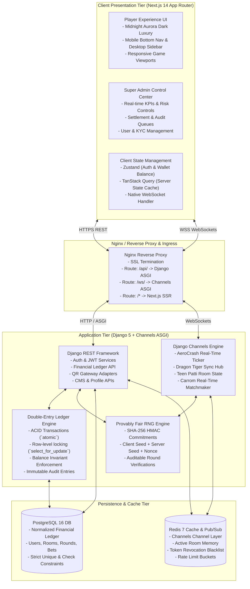
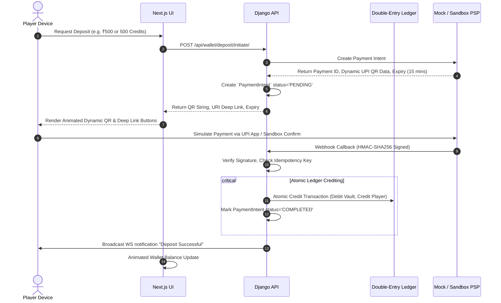

# VELTRIX ARENA — System Architecture Specification

## 1. High-Level Architecture Diagram



---

## 2. Directory & Component Structure

```
expermtnal/
├── backend/                        # Python Django 5 + Channels Backend
│   ├── manage.py
│   ├── requirements.txt
│   ├── Dockerfile
│   ├── veltrix/                    # Core project settings & ASGI/WS routing
│   │   ├── __init__.py
│   │   ├── settings.py
│   │   ├── urls.py
│   │   ├── asgi.py
│   │   └── wsgi.py
│   ├── apps/
│   │   ├── accounts/               # Authentication, KYC, Sessions, Profiles
│   │   ├── wallet/                 # Double-entry ledger, QR payments, Payouts
│   │   ├── games/                  # Game catalog, Round models, Provably Fair RNG
│   │   ├── crash/                  # AeroCrash game engine & consumers
│   │   ├── dragontiger/            # Dragon Tiger game engine & consumers
│   │   ├── teenpatti/              # Multiplayer Teen Patti engine & rooms
│   │   ├── carrom/                 # Carrom 2D multiplayer room & state
│   │   ├── promotions/             # VIP tiers, Daily Rewards, Referral links
│   │   ├── admin_center/           # Operational KPIs, Financial reports, Audit logs
│   │   └── cms/                    # Website branding, Banners, Announcements
│   └── tests/                      # Automated test suite
│
├── frontend/                       # Next.js 14 App Router Frontend
│   ├── package.json
│   ├── tsconfig.json
│   ├── tailwind.config.ts
│   ├── next.config.js
│   ├── public/                     # Icons, static game assets, PWA manifest
│   └── src/
│       ├── app/                    # Next.js App Router
│       │   ├── layout.tsx          # Root layout with Midnight Aurora provider
│       │   ├── page.tsx            # Premium Landing page
│       │   ├── (auth)/             # Login, Register, Forgot Password
│       │   ├── (player)/           # Player Shell (Dashboard, Lobby, Wallet, VIP)
│       │   │   ├── dashboard/
│       │   │   ├── games/          # Game lobby & individual game rooms
│       │   │   │   ├── aerocrash/
│       │   │   │   ├── dragontiger/
│       │   │   │   ├── teenpatti/
│       │   │   │   └── carrom/
│       │   │   ├── wallet/         # Deposit (QR), Withdraw, Transactions
│       │   │   ├── rewards/        # Daily bonus, VIP tiers, Referral hub
│       │   │   ├── leaderboard/
│       │   │   ├── support/
│       │   │   └── profile/
│       │   └── (admin)/            # Super Admin Control Center (`/admin`)
│       │       ├── admin/
│       │       │   ├── overview/
│       │       │   ├── users/
│       │       │   ├── games/
│       │       │   ├── finance/
│       │       │   ├── deposits/
│       │       │   ├── withdrawals/
│       │       │   ├── promotions/
│       │       │   ├── cms/
│       │       │   └── audit/
│       ├── components/             # Reusable UI primitives & game canvases
│       ├── hooks/                  # Custom WebSocket and state hooks
│       ├── lib/                    # API client, formatting, game physics helpers
│       └── store/                  # Zustand global stores (auth, wallet, ui)
│
├── nginx/                          # Nginx configuration for production/Docker
├── docker-compose.yml              # Multi-container orchestration
└── docs/                           # Extended documentation
```

---

## 3. Double-Entry Accounting Ledger Specification

Every financial event in VELTRIX ARENA strictly follows double-entry bookkeeping principles. No account balance can be modified by a standalone `UPDATE wallet SET balance = ...`. Balance changes occur exclusively through balanced debits and credits in the `LedgerEntry` table.

### Account Chart

| Account Code | Account Type | Name | Normal Balance | Description |
| :--- | :--- | :--- | :--- | :--- |
| `1000` | ASSET | Platform Vault / Gateway Holding | Debit | Real funds collected by payment aggregators. |
| `1100` | ASSET | Player Demo Credit Reserve | Debit | Pool supporting demo credits. |
| `2000` | LIABILITY | Player Main Balance | Credit | Funds owed to registered players. |
| `2100` | LIABILITY | Player Demo Balance | Credit | Active demo play funds for testing. |
| `2200` | LIABILITY | Player Bonus Balance | Credit | Non-withdrawable promotional credit. |
| `2300` | LIABILITY | In-Play Locked / Escrow Balance | Credit | Wagers locked in active, uncompleted game rounds. |
| `4000` | REVENUE | Gross Game Revenue (House Take) | Credit | Net retained game margin upon round completion. |
| `5000` | EXPENSE | Promotional Bonus Expenditure | Debit | Marketing spend on daily claims and VIP rewards. |
| `5100` | EXPENSE | Affiliate / Referral Commission | Debit | Payouts to user referrers. |

### Invariant & Integrity Protections
1. $\sum \text{Debit} - \sum \text{Credit} = 0$ for every `Transaction` envelope.
2. Balance calculation is derived from ledger sums or verified against an atomic snapshot cached with row-locking (`select_for_update`).
3. Negative balances are prohibited at both application and database `CHECK (balance >= 0)` constraints.
4. Idempotency Key check prevents duplicate processing of game bets, payouts, and payment webhooks.

---

## 4. Provably Fair RNG & Game Engine Architecture

### Provably Fair Algorithm
For each round $R$:
1. **Server Seed Generation**: Backend generates a cryptographically secure random string $S_{server}$ using Python's `secrets.token_hex(32)` and publishes $H_{server} = \text{SHA-256}(S_{server})$ *before* betting opens.
2. **Client Seed Contribution**: Combined with the client seed $S_{client}$ (either user-provided or round-nonce based) and $Nonce$.
3. **Outcome Calculation**:
   $$\text{HMAC} = \text{HMAC-SHA256}(S_{server}, S_{client} + ":" + Nonce)$$
4. For **AeroCrash**:
   The first 52 bits of the HMAC are parsed as an integer $I$.
   $$\text{Crash Point} = \max\left(1.00, \left\lfloor \frac{100 \times 2^{52}}{2^{52} - I} \times (1 - \text{HouseEdge}) \right\rfloor \div 100\right)$$
5. **Round Reveal**: Once the round ends, $S_{server}$ is published in cleartext so any player can independently verify that the outcome was predetermined and unmanipulated.

---

## 5. Dynamic QR Payment Gateway Engine



---

## 6. Real-Time WebSocket Protocols

All WebSocket connections route via Django Channels ASGI consumers with JWT authentication passed via query parameter or connection payload.

### Channels & Topics
- `/ws/crash/`: AeroCrash multiplayer ticker (`round_starting`, `tick` with live multiplier, `crashed`, `player_bet`, `player_cashed_out`).
- `/ws/dragontiger/`: Dragon Tiger live table (`new_shoe`, `betting_open`, `cards_dealt`, `round_settled`).
- `/ws/teenpatti/{room_id}/`: Room-based multiplayer state (`player_joined`, `dealt_hands`, `turn_active`, `action_call`, `action_raise`, `action_pack`, `showdown_result`).
- `/ws/carrom/{room_id}/`: Match synchronized state (`turn_change`, `strike_vector`, `pocket_event`, `queen_cover_pending`, `game_over`).
- `/ws/notifications/{user_id}/`: Personal user alerts, wallet settlements, and administrative notices.
