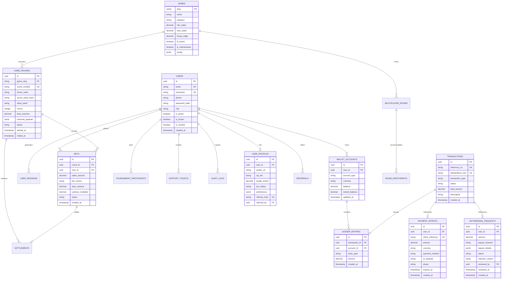

# VELTRIX ARENA — Database Schema Specification

## 1. Entity-Relationship Diagram (ERD)

---

## 2. Table Specifications

### 2.1 Accounts & Identity

#### `users`
- `id` (UUID, Primary Key, default `gen_random_uuid()`)
- `email` (VARCHAR(255), Unique, Not Null, Index)
- `username` (VARCHAR(50), Unique, Not Null, Index)
- `phone` (VARCHAR(30), Nullable)
- `password_hash` (VARCHAR(255), Not Null)
- `role` (VARCHAR(30), Default `'player'`): Enum: `player`, `support`, `finance_manager`, `game_manager`, `operations_admin`, `super_admin`.
- `is_active` (BOOLEAN, Default `true`)
- `is_frozen` (BOOLEAN, Default `false`)
- `is_verified` (BOOLEAN, Default `false`)
- `two_factor_enabled` (BOOLEAN, Default `false`)
- `created_at` (TIMESTAMPTZ, Default `NOW()`)
- `updated_at` (TIMESTAMPTZ, Default `NOW()`)

#### `user_profiles`
- `id` (UUID, Primary Key)
- `user_id` (UUID, Foreign Key `users.id`, On Delete CASCADE, Unique)
- `avatar_url` (VARCHAR(500), Nullable)
- `vip_tier` (VARCHAR(30), Default `'BRONZE'`) — `BRONZE`, `SILVER`, `GOLD`, `PLATINUM`, `DIAMOND`, `ELITE`
- `loyalty_points` (DECIMAL(18, 4), Default `0.0000`)
- `kyc_status` (VARCHAR(30), Default `'UNVERIFIED'`) — `UNVERIFIED`, `PENDING`, `VERIFIED`, `REJECTED`
- `kyc_notes` (TEXT, Nullable)
- `referral_code` (VARCHAR(32), Unique, Not Null)
- `referred_by_id` (UUID, Foreign Key `users.id`, Nullable)
- `preferences` (JSONB, Default `'{"sound": true, "auto_cashout": true, "theme": "midnight_aurora"}'`)
- `created_at` (TIMESTAMPTZ, Default `NOW()`)

---

### 2.2 Double-Entry Financial Ledger & Wallets

#### `wallet_accounts`
- `id` (UUID, Primary Key)
- `user_id` (UUID, Foreign Key `users.id`, On Delete RESTRICT)
- `account_type` (VARCHAR(30), Not Null):
  - `MAIN`: Withdrawable/playable cash credit
  - `DEMO`: Free-play virtual credits (default initial 10,000.00)
  - `BONUS`: Promotional credit subject to rollover
  - `ESCROW`: Currently staked in active live game rounds
- `currency` (VARCHAR(10), Default `'INR'`)
- `balance` (DECIMAL(18, 4), Default `0.0000`, Check `balance >= 0.0000`)
- `locked_balance` (DECIMAL(18, 4), Default `0.0000`, Check `locked_balance >= 0.0000`)
- `updated_at` (TIMESTAMPTZ, Default `NOW()`)
- *Unique Constraint*: (`user_id`, `account_type`, `currency`)

#### `transactions`
- `id` (UUID, Primary Key)
- `reference_no` (VARCHAR(64), Unique, Not Null, Index)
- `idempotency_key` (VARCHAR(128), Unique, Nullable, Index)
- `transaction_type` (VARCHAR(40), Not Null):
  `DEPOSIT`, `WITHDRAWAL`, `GAME_BET`, `GAME_WIN`, `GAME_REFUND`, `BONUS_CREDIT`, `REFERRAL_PAYOUT`
- `status` (VARCHAR(20), Default `'PENDING'`): `PENDING`, `COMPLETED`, `FAILED`, `CANCELLED`
- `total_amount` (DECIMAL(18, 4), Not Null)
- `description` (TEXT)
- `metadata` (JSONB, Default `'{}'`)
- `created_at` (TIMESTAMPTZ, Default `NOW()`)

#### `ledger_entries`
- `id` (UUID, Primary Key)
- `transaction_id` (UUID, Foreign Key `transactions.id`, On Delete CASCADE)
- `account_id` (UUID, Foreign Key `wallet_accounts.id`, On Delete RESTRICT)
- `entry_type` (VARCHAR(10), Not Null): `DEBIT` or `CREDIT`
- `amount` (DECIMAL(18, 4), Check `amount > 0.0000`)
- `balance_after` (DECIMAL(18, 4), Not Null)
- `created_at` (TIMESTAMPTZ, Default `NOW()`)

---

### 2.3 Payments & Gateways

#### `payment_intents`
- `id` (UUID, Primary Key)
- `user_id` (UUID, Foreign Key `users.id`)
- `intent_reference` (VARCHAR(64), Unique, Not Null)
- `amount` (DECIMAL(18, 4), Not Null)
- `currency` (VARCHAR(10), Default `'INR'`)
- `payment_method` (VARCHAR(30), Default `'UPI_QR'`)
- `qr_payload` (TEXT, Not Null)
- `status` (VARCHAR(20), Default `'PENDING'`) — `PENDING`, `COMPLETED`, `EXPIRED`, `FAILED`
- `gateway_provider` (VARCHAR(50), Default `'SANDBOX_UPI'`)
- `gateway_reference` (VARCHAR(128), Nullable)
- `expires_at` (TIMESTAMPTZ, Not Null)
- `created_at` (TIMESTAMPTZ, Default `NOW()`)

#### `withdrawal_requests`
- `id` (UUID, Primary Key)
- `user_id` (UUID, Foreign Key `users.id`)
- `amount` (DECIMAL(18, 4), Not Null)
- `payout_channel` (VARCHAR(30), Not Null): `UPI`, `IMPS`, `CRYPTO`, `SANDBOX`
- `payout_details` (JSONB, Not Null): e.g., `{"upi_id": "player@okhdfcbank"}`
- `status` (VARCHAR(20), Default `'PENDING'`) — `PENDING`, `UNDER_REVIEW`, `APPROVED`, `REJECTED`, `COMPLETED`
- `reviewed_by` (UUID, Foreign Key `users.id`, Nullable)
- `reviewed_at` (TIMESTAMPTZ, Nullable)
- `rejection_reason` (TEXT, Nullable)
- `created_at` (TIMESTAMPTZ, Default `NOW()`)

---

### 2.4 Games, Rounds & Provable Fairness

#### `games`
- `slug` (VARCHAR(50), Primary Key) — `aerocrash`, `dragontiger`, `teenpatti`, `carrom`
- `name` (VARCHAR(100), Not Null)
- `category` (VARCHAR(50), Not Null): `CRASH`, `TABLE`, `CARDS`, `SKILL`
- `thumbnail_url` (VARCHAR(500))
- `min_stake` (DECIMAL(18, 4), Default `10.0000`)
- `max_stake` (DECIMAL(18, 4), Default `10000.0000`)
- `house_edge` (DECIMAL(5, 4), Default `0.0300`) — e.g. 3.00%
- `is_active` (BOOLEAN, Default `true`)
- `is_maintenance` (BOOLEAN, Default `false`)
- `config` (JSONB, Default `'{}'`)
- `created_at` (TIMESTAMPTZ, Default `NOW()`)

#### `game_rounds`
- `id` (UUID, Primary Key)
- `game_slug` (VARCHAR(50), Foreign Key `games.slug`)
- `round_number` (VARCHAR(64), Unique, Not Null, Index)
- `server_seed` (VARCHAR(128), Not Null) — revealed *after* round ends
- `server_seed_hash` (VARCHAR(64), Not Null) — SHA-256 published *before* round starts
- `client_seed` (VARCHAR(128), Not Null)
- `nonce` (INTEGER, Default `1`)
- `final_outcome` (DECIMAL(18, 4), Nullable) — e.g. 2.45x for Crash, or Winner code
- `outcome_payload` (JSONB, Default `'{}'`) — full deck or game result metadata
- `status` (VARCHAR(20), Default `'SCHEDULED'`): `SCHEDULED`, `BETTING_OPEN`, `IN_PROGRESS`, `SETTLED`, `CANCELLED`
- `started_at` (TIMESTAMPTZ, Nullable)
- `ended_at` (TIMESTAMPTZ, Nullable)
- `created_at` (TIMESTAMPTZ, Default `NOW()`)

#### `bets`
- `id` (UUID, Primary Key)
- `round_id` (UUID, Foreign Key `game_rounds.id`, On Delete RESTRICT)
- `user_id` (UUID, Foreign Key `users.id`, On Delete RESTRICT)
- `account_id` (UUID, Foreign Key `wallet_accounts.id`, On Delete RESTRICT)
- `stake_amount` (DECIMAL(18, 4), Not Null)
- `bet_choice` (VARCHAR(50), Default `'CRASH'`) — `'DRAGON'`, `'TIGER'`, `'TIE'`, `'CHAAL'`, etc.
- `auto_cashout` (DECIMAL(10, 2), Nullable)
- `cashout_multiplier` (DECIMAL(10, 2), Nullable)
- `payout_amount` (DECIMAL(18, 4), Default `0.0000`)
- `status` (VARCHAR(20), Default `'PLACED'`): `PLACED`, `WON`, `LOST`, `CANCELLED`, `CASHED_OUT`
- `created_at` (TIMESTAMPTZ, Default `NOW()`)

---

### 2.5 Multiplayer & Rooms

#### `multiplayer_rooms`
- `id` (UUID, Primary Key)
- `game_slug` (VARCHAR(50), Foreign Key `games.slug`)
- `room_code` (VARCHAR(16), Unique, Not Null)
- `room_type` (VARCHAR(20), Default `'PUBLIC'`): `PUBLIC`, `PRIVATE`, `TOURNAMENT`
- `max_players` (INTEGER, Default `5`)
- `boot_amount` (DECIMAL(18, 4), Default `50.0000`)
- `status` (VARCHAR(20), Default `'WAITING'`): `WAITING`, `ACTIVE`, `FINISHED`, `CLOSED`
- `created_by` (UUID, Foreign Key `users.id`, Nullable)
- `room_state` (JSONB, Default `'{}'`)
- `created_at` (TIMESTAMPTZ, Default `NOW()`)

#### `room_participants`
- `id` (UUID, Primary Key)
- `room_id` (UUID, Foreign Key `multiplayer_rooms.id`, On Delete CASCADE)
- `user_id` (UUID, Foreign Key `users.id`, On Delete CASCADE)
- `seat_number` (INTEGER, Not Null)
- `is_ready` (BOOLEAN, Default `false`)
- `is_folded` (BOOLEAN, Default `false`)
- `cards` (JSONB, Default `'[]'`)
- `current_stake` (DECIMAL(18, 4), Default `0.0000`)
- `joined_at` (TIMESTAMPTZ, Default `NOW()`)
- *Unique Constraint*: (`room_id`, `seat_number`), (`room_id`, `user_id`)

---

### 2.6 Audit Logs & Security

#### `audit_logs`
- `id` (UUID, Primary Key)
- `actor_id` (UUID, Foreign Key `users.id`, Nullable)
- `ip_address` (VARCHAR(45), Nullable)
- `action` (VARCHAR(100), Not Null)
- `resource_type` (VARCHAR(50), Not Null)
- `resource_id` (VARCHAR(100), Nullable)
- `payload` (JSONB, Default `'{}'`)
- `created_at` (TIMESTAMPTZ, Default `NOW()`)
